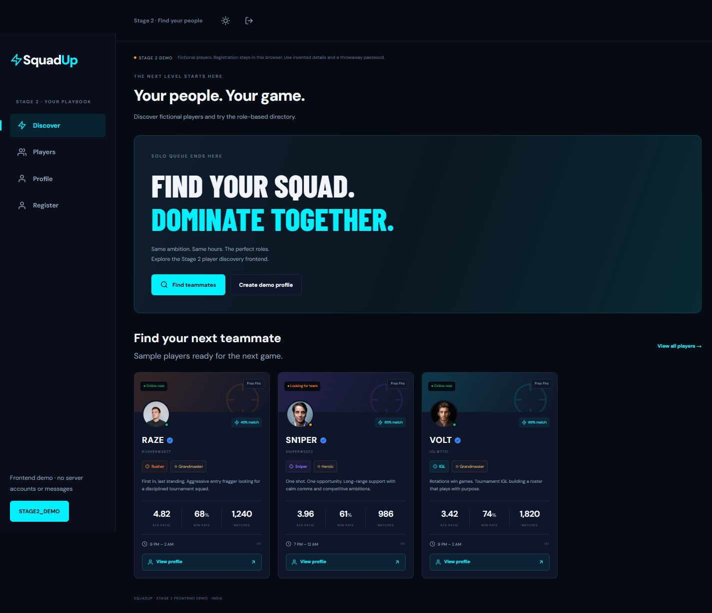

# SquadUp — Esports Team Finder

A mobile-first application that helps esports players find compatible teammates,
build five-player squads, and communicate through direct and squad chat.

**Stack:** React · Vite · Tailwind CSS · Express · PostgreSQL · Sequelize · Socket.io

[Try locally](#try-the-browser-demo) · [Full-stack setup](DEVELOPMENT.md#run-the-full-stack) ·
[API reference](DEVELOPMENT.md#api-overview) · [Verification](VERIFICATION.md)

## What the application does

- Player discovery with filters for game, role, rank, schedule, and device.
- Weighted teammate matching using role, schedule overlap, rank, and age proximity.
- Player profiles, five-slot squads, invitations, and leader-reviewed join requests.
- Authenticated direct and squad messaging with typing, presence, and read events.
- Private screenshot uploads, with local image decoding and WebP re-encoding.
- A browser demo plus a full-stack mode backed by PostgreSQL.

## Interface preview



*Screenshot from the earlier Stage 2 browser demo. Current source also includes
the backend and additional squad and messaging features.*

## Try the browser demo

Requires Node.js 22 or later and npm. From the repository root:

```sh
npm ci
npm run dev
```

Open the URL printed by Vite, normally `http://localhost:5173`. Without an environment
file the client starts a labelled browser-only demo with fictional data. It does not
call the backend. Use invented details and a throwaway password.

## Run the full application

The full stack requires PostgreSQL and an ignored `.env` configured from `.env.example`.
Set `VITE_DEMO_MODE=false`, configure the database and signing secret, run migrations,
and start the API and frontend separately. Follow the complete
[full-stack setup](DEVELOPMENT.md#run-the-full-stack) before creating accounts.

`FREE_MODE=true` supports a local workflow without paid AI, SMS, Redis, or S3 calls.
Its bio templates and roster rules are labelled deterministic features, rather than
AI-generated results. External integrations are optional and have separate verification requirements.

## Architecture

| Component | Responsibility |
| --- | --- |
| React client | Discovery, profiles, squad flows, and messaging interface |
| Express API | Validation, authentication, player and squad operations |
| PostgreSQL / Sequelize | Accounts, relationships, messages, and versioned migrations |
| Socket.io | Authenticated real-time chat and presence |
| Upload storage | Access-controlled attachments; local and optional S3 paths |

## Development checks

```sh
npm test
npm run build
```

Database integration tests need a dedicated test database. See the
[development reference](DEVELOPMENT.md#verification) and [verification record](VERIFICATION.md)
for requirements and previously recorded results.

## Project status and further reading

Full application source is available; this repository is not a hosted production
service. Cloud deployment and optional external adapters need independent verification.
See [remaining launch work](DEVELOPMENT.md#remaining-launch-work) for open items.

- [Development, API, storage, and deployment reference](DEVELOPMENT.md)
- [Full release notes](docs/FULL-RELEASE.md)
- [Contributor reading guide](docs/reader-guide.md)
- [AWS deployment plan](deploy/AWS.md)
