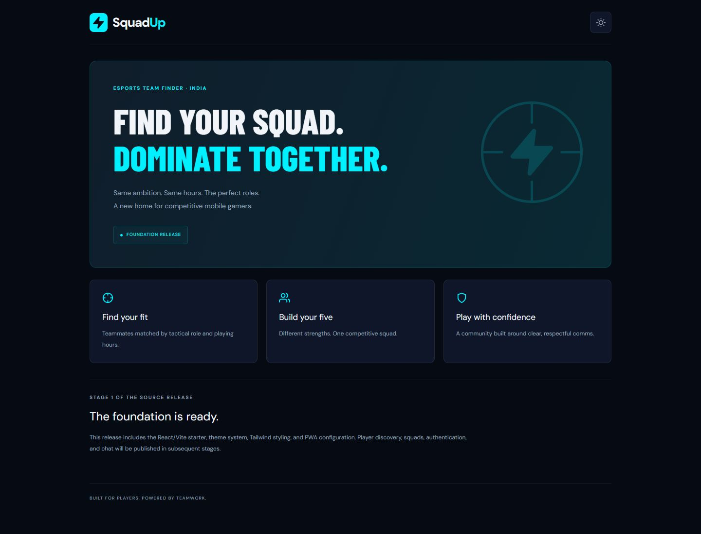
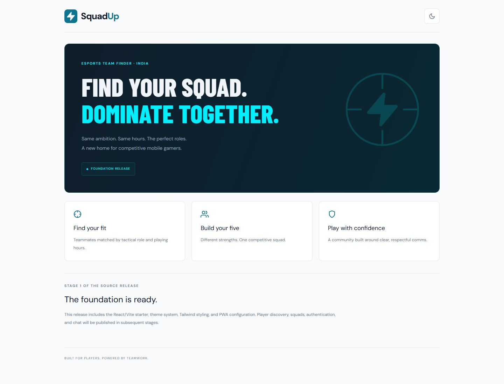
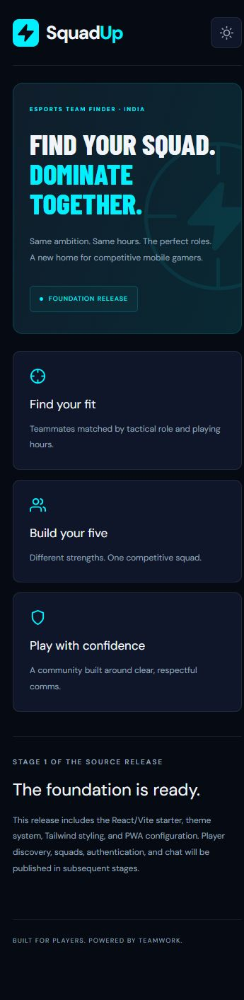
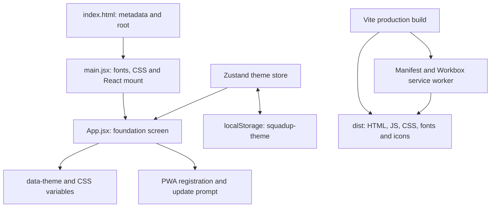

> Archived Stage 1 guide. For the current Stage 2 release, see [README](../README.md). Source-file links below refer to the original foundation commit.

# SquadUp — Esports Team Finder

**Find your squad. Dominate together.**

A mobile-first project for India's competitive mobile gamers, starting with Free Fire and intended to expand to BGMI and CODM. The product aims to help players find teammates by tactical role and playing hours, build five-player squads and communicate together.

**Published source: Stage 1 · Frontend foundation · Version 0.1.0**

This guide documents the code available in this repository. The foundation was published in [commit f221688](https://github.com/tanishqsgit/ETF-SQUAD-UP/commit/f221688d57a216a67dbe21fcc8a5fc75a64f809f). Later implementation exists in the local workspace but is not included in this source release. This update adds documentation and screenshots; it does not publish those later features.

## Contents

- [Screenshots](#screenshots)
- [Release scope](#release-scope)
- [Tech stack](#tech-stack)
- [Step-by-step setup](#step-by-step-setup)
- [How it works](#how-it-works)
- [Project structure](#project-structure)
- [Design and themes](#design-and-themes)
- [PWA and offline behavior](#pwa-and-offline-behavior)
- [Configuration and commands](#configuration-and-commands)
- [Hosting preparation](#hosting-preparation)
- [Verification](#verification)
- [Troubleshooting](#troubleshooting)
- [Release roadmap](#release-roadmap)
- [Development notes](#development-notes)

## Screenshots

Actual screenshots of the **Stage 1 production build**, captured on **October 13, 2026**. These show this repository's code, not mockups or the newer local full-stack app. The temporary screenshot preview used port `4181`; normal preview defaults to `4173`.

### Desktop — dark theme

Hero, three informational feature cards, release note and footer at a 1440px viewport.



### Desktop — light theme

The surrounding page and cards use light tokens; the gaming hero keeps its dark gradient.

<details>
<summary>View the light-theme screenshot</summary>



</details>

### Mobile — dark theme

At a 360px viewport, the heading wraps and cards stack vertically.



## Release scope

| Included                   | Working behavior                                                                |
| -------------------------- | ------------------------------------------------------------------------------- |
| Responsive foundation page | Branded header, hero, three project-direction cards, release note and footer    |
| Dark/light themes          | Header toggle; selection survives reloads in the same browser/origin            |
| Design tokens              | CSS variables for background, surface, text, border and accent                  |
| Typography and icons       | Locally bundled fonts and Feather icons                                         |
| PWA setup                  | Production manifest, generated service worker, shell precache and install icons |
| Update interface           | Explicit update button when a newer service worker is detected                  |
| Reproducible dependencies  | Committed npm lockfile                                                          |

**Not published yet:** discovery/filtering, registration/login, player profiles, squad management, invitations, compatibility calculations, live chat, image uploads, databases/APIs, AI, SMS or cloud deployment. The game names describe the intended audience, not live integrations. Feature cards are informational and do not open those future features.

## Tech stack

Exact versions below come from the committed `package-lock.json`. The ranges in `package.json` may permit newer versions; `npm ci` installs the locked tree.

| Area              | Package                                               | Locked version | Purpose                                                  |
| ----------------- | ----------------------------------------------------- | -------------- | -------------------------------------------------------- |
| UI                | `react`, `react-dom`                                  | 18.3.1         | Components, rendering and Strict Mode                    |
| Build/development | `vite`                                                | 6.4.4          | Development server and production bundling               |
| React integration | `@vitejs/plugin-react`                                | 4.7.0          | React transformation and development refresh             |
| Styling           | `tailwindcss`, `@tailwindcss/vite`                    | 4.3.3          | Tailwind v4 pipeline, alongside custom CSS               |
| State             | `zustand`                                             | 5.0.15         | Isolated persisted theme store                           |
| Icons             | `react-icons`                                         | 5.7.0          | Crosshair, users, shield, sun, moon and lightning        |
| PWA               | `vite-plugin-pwa`                                     | 1.3.0          | Manifest, Workbox generation and React registration hook |
| Fonts             | `@fontsource/dm-sans`, `@fontsource/barlow-condensed` | 5.3.0          | Bundled font assets                                      |
| Formatting        | `prettier`                                            | 3.9.10         | Source formatting                                        |
| Prerequisite      | Node.js                                               | >=22           | Project's runtime requirement                            |

This stage has **no React Router, Axios, Socket.io, Express, Sequelize, PostgreSQL or OpenAI dependencies**. They belong to later source releases; cloning this version does not install a backend.

## Step-by-step setup

### 1. Check prerequisites

Install Node.js 22 or a compatible later version with npm, and Git for cloning. Use a browser and an editor such as VS Code.

```sh
node --version
npm --version
git --version
```

No database, Docker, API key, SMS provider or cloud account is required. The foundation needs no paid service to run locally; device and network costs are separate.

### 2. Clone and enter the project

```sh
git clone https://github.com/tanishqsgit/ETF-SQUAD-UP.git
cd ETF-SQUAD-UP
```

Alternatively, download/extract the repository ZIP and open a terminal in its folder.

### 3. Install exact dependencies

```sh
npm ci
```

This uses the lockfile and needs internet access for uncached packages. Keep `package.json` and `package-lock.json` from the same source checkout.

### 4. Set the base path only if needed

Normal local use defaults to `/`, so `.env` is optional. To copy the public example in Windows PowerShell:

```powershell
Copy-Item .env.example .env
```

On macOS/Linux:

```sh
cp .env.example .env
```

Keep `VITE_BASE_PATH=/` locally. `VITE_` settings are client/build configuration; never place private keys or passwords in them.

### 5. Start the development server

```sh
npm run dev
```

Open the printed URL, normally **http://localhost:5173/**. Vite may choose another port if it is occupied; follow the terminal URL rather than an unrelated app already running there.

The command binds to `0.0.0.0` and may print a LAN address. Access from another device depends on the network/firewall. This is a development server, not a public production deployment.

### 6. Try the working screen

1. Check the Foundation Release badge and Stage 1 release note.
2. Click the sun icon to switch to light mode.
3. Reload; light mode should persist.
4. Click the moon icon to return to dark mode.
5. Resize the browser; small screens display the cards in one column.

There are no account forms, squad actions or chat rooms in this release.

### 7. Preview a production build

```sh
npm run build
npm run preview
```

Open the preview URL, normally **http://localhost:4173/**. Production assets are generated in `dist/`. Preview serves the existing build; it does not automatically rebuild edits. Stop either server with `Ctrl+C`.

## How it works



1. `index.html` provides the metadata and `root` mount element.
2. `main.jsx` imports global CSS/fonts and mounts `App` inside `React.StrictMode`.
3. `App` renders the static foundation and subscribes to theme state.
4. A theme effect changes the root HTML `data-theme` attribute and the `theme-color` meta tag.
5. The theme action updates Zustand; persistence saves the choice locally.
6. The production PWA hook registers the generated service worker and exposes update state.

There are no player/API requests. The theme choice is not sent to a server.

## Project structure

```text
ETF-SQUAD-UP/
├── docs/screenshots/
│   ├── stage-1-desktop-dark.jpg
│   ├── stage-1-desktop-light.jpg
│   └── stage-1-mobile-dark.jpg
├── public/
│   ├── icon.svg
│   ├── icon-192.png
│   └── icon-512.png
├── src/
│   ├── stores/themeStore.js
│   ├── App.jsx
│   ├── main.jsx
│   └── styles.css
├── .env.example
├── .gitignore
├── .prettierrc.json
├── index.html
├── package.json
├── package-lock.json
├── README.md
└── vite.config.js
```

| File                                                   | Responsibility                                                                           |
| ------------------------------------------------------ | ---------------------------------------------------------------------------------------- |
| [`index.html`](https://github.com/tanishqsgit/ETF-SQUAD-UP/blob/f221688d57a216a67dbe21fcc8a5fc75a64f809f/index.html)                             | Title, description, viewport, theme metadata, favicon, root element and module entry     |
| [`src/main.jsx`](https://github.com/tanishqsgit/ETF-SQUAD-UP/blob/f221688d57a216a67dbe21fcc8a5fc75a64f809f/src/main.jsx)                         | Font/style imports and React mount                                                       |
| [`src/App.jsx`](https://github.com/tanishqsgit/ETF-SQUAD-UP/blob/f221688d57a216a67dbe21fcc8a5fc75a64f809f/src/App.jsx)                           | Static feature array, page sections, theme action/effect and update button               |
| [`src/stores/themeStore.js`](https://github.com/tanishqsgit/ETF-SQUAD-UP/blob/f221688d57a216a67dbe21fcc8a5fc75a64f809f/src/stores/themeStore.js) | Dark default, toggle action and persisted state                                          |
| [`src/styles.css`](https://github.com/tanishqsgit/ETF-SQUAD-UP/blob/f221688d57a216a67dbe21fcc8a5fc75a64f809f/src/styles.css)                     | Tailwind import, color tokens, component styles, focus states and mobile breakpoint      |
| [`vite.config.js`](https://github.com/tanishqsgit/ETF-SQUAD-UP/blob/f221688d57a216a67dbe21fcc8a5fc75a64f809f/vite.config.js)                     | Base path, three plugins, manifest, cache patterns and development port                  |
| [`public/`](https://github.com/tanishqsgit/ETF-SQUAD-UP/blob/f221688d57a216a67dbe21fcc8a5fc75a64f809f/public/)                                   | Favicon and install icons copied to production                                           |
| [`package.json`](https://github.com/tanishqsgit/ETF-SQUAD-UP/blob/f221688d57a216a67dbe21fcc8a5fc75a64f809f/package.json)                         | Metadata, commands, runtime requirement and dependency ranges                            |
| [`package-lock.json`](https://github.com/tanishqsgit/ETF-SQUAD-UP/blob/f221688d57a216a67dbe21fcc8a5fc75a64f809f/package-lock.json)               | Exact npm dependency tree                                                                |
| [`.env.example`](https://github.com/tanishqsgit/ETF-SQUAD-UP/blob/f221688d57a216a67dbe21fcc8a5fc75a64f809f/.env.example)                         | Public base-path example                                                                 |
| [`.gitignore`](https://github.com/tanishqsgit/ETF-SQUAD-UP/blob/f221688d57a216a67dbe21fcc8a5fc75a64f809f/.gitignore)                             | Excludes dependencies, builds, private env files, logs, coverage and temporary artifacts |
| [`.prettierrc.json`](https://github.com/tanishqsgit/ETF-SQUAD-UP/blob/f221688d57a216a67dbe21fcc8a5fc75a64f809f/.prettierrc.json)                 | Formatting preferences                                                                   |
| [`docs/screenshots/`](screenshots/)               | Tracked images embedded in this guide                                                    |

`node_modules/` and `dist/` are generated locally and ignored. No `server/`, migrations or API routes exist in this published stage.

## Design and themes

### Actual color tokens

| Variable      | Dark theme               | Light theme |
| ------------- | ------------------------ | ----------- |
| `--bg`        | `#060A13`                | `#F8FAFC`   |
| `--surface`   | `#0F1629`                | `#FFFFFF`   |
| `--text`      | `#F1F5F9`                | `#0F172A`   |
| `--secondary` | `#94A3B8`                | `#64748B`   |
| `--border`    | `rgba(255,255,255,0.08)` | `#E2E8F0`   |
| `--accent`    | `#00F0FF`                | `#0E7490`   |

The hero has a fixed navy/teal gradient and cyan heading in both modes. Other planned status/rank/premium tokens are not all implemented in this foundation.

### Typography, responsiveness and accessibility

- DM Sans weights 400, 600 and 700 are imported for interface text.
- Barlow Condensed weight 800 is imported for the hero headline.
- Font files are bundled locally; no hosted font API is needed at runtime.
- Heading size uses `clamp(40px, 7vw, 72px)`.
- The centered shell has an `1120px` maximum width.
- Cards use three equal columns and `18px` gaps above `600px`.
- At `600px` and below, cards stack, padding decreases and the decorative icon shifts away from text.
- The theme button has at least a `44px` touch target, a descriptive action label and visible keyboard focus styling.
- The page uses semantic landmarks/headings. Decorative hero graphics use `aria-hidden`.

Mobile bottom navigation and a full-app desktop sidebar are later features. No formal accessibility certification is claimed.

### Persisted theme behavior

`useThemeStore` starts with `theme: 'dark'`. `toggleTheme()` switches the value; Zustand `persist` saves it under **`squadup-theme`** in localStorage. `App` sets `document.documentElement.dataset.theme` and updates the browser theme-color to `#060A13` or `#F8FAFC`.

Persistence belongs to that browser/origin. A preference at `localhost:5173` does not transfer automatically to `localhost:4173`, another browser or another device. Clearing site data resets it. Appearance state contains no account credentials.

## PWA and offline behavior

| Setting                  | Configuration                                                   |
| ------------------------ | --------------------------------------------------------------- |
| Name / short name        | `SquadUp — Esports Team Finder` / `SquadUp`                     |
| Display                  | `standalone`                                                    |
| Theme / background color | `#060A13`                                                       |
| Start URL / scope        | Configured base path                                            |
| Icons                    | 192×192 PNG; 512×512 PNG declared for `any maskable`; SVG asset |
| Registration             | `prompt`                                                        |
| Precache patterns        | JS, CSS, HTML, SVG, PNG and WOFF2                               |
| Navigation fallback      | `<base>index.html`                                              |
| Runtime cache rules      | None                                                            |

Build output contains `manifest.webmanifest`, `sw.js` and a Workbox helper. The verified documentation build produced **15 precache entries, approximately 250.01 KiB**; this changes with source/dependencies and files scanned by the styling pipeline.

Test the PWA using the production preview on localhost or an appropriate HTTPS host. Development mode does not enable this production cache. A successful first online visit is needed to cache the shell; an unvisited page cannot load offline. Once cached, this static foundation can reload with its server unavailable. It has no live API/multiplayer data to cache.

When `needRefresh` is true, **“New version available · Update”** appears. Clicking calls `updateServiceWorker(true)` to activate/reload. The button is conditional, not always visible. A two-release deployment update scenario has not been verified here.

Installation UI varies by browser/device. Use the browser's install/add-to-home-screen action if offered. Successful PWA generation does not prove installation on every device; installation itself was not verified in this update.

## Configuration and commands

| Setting          | Default | Purpose                                                                                 |
| ---------------- | ------- | --------------------------------------------------------------------------------------- |
| `VITE_BASE_PATH` | `/`     | Public asset URL prefix, home link, PWA start/scope, icon paths and navigation fallback |

The Vite config reads `VITE_` settings through `loadEnv`. Restart development after env changes and rebuild after changing the deployment prefix.

| Command           | Behavior                                                  |
| ----------------- | --------------------------------------------------------- |
| `npm ci`          | Install the locked dependency tree                        |
| `npm run dev`     | Start Vite, requesting port 5173, bound to all interfaces |
| `npm run build`   | Create production/PWA output in `dist/`                   |
| `npm run preview` | Serve the existing build locally                          |
| `npm run format`  | Prettier write mode on `src` and `vite.config.js`         |
| `npm audit`       | Query npm dependency advisories                           |

There is no `npm test`, seed, migration or backend-start script in Stage 1. Formatting changes source files; inspect the resulting diff. The formatter uses single quotes, trailing commas where supported and a 100-character print width.

To choose a free port explicitly and prevent fallback:

```sh
npm run dev -- --port 5174 --strictPort
```

For a production preview after building:

```sh
npm run preview -- --port 4181 --strictPort
```

Run each server in its own terminal.

## Hosting preparation

This repository contains source, **not an enabled hosted deployment**. A configured static host can serve the generated `dist/` files. Preview is for local inspection, not production hosting.

Use `/` for domain-root hosting. A future GitHub Pages project site at `/ETF-SQUAD-UP/` needs that exact prefix, including the trailing slash. Windows PowerShell example:

```powershell
$env:VITE_BASE_PATH = '/ETF-SQUAD-UP/'
npm run build
Remove-Item Env:VITE_BASE_PATH
```

macOS/Linux example:

```sh
VITE_BASE_PATH=/ETF-SQUAD-UP/ npm run build
```

Configure the host and deploy `dist/` separately. This documentation push enables no Pages workflow, public website, custom domain, HTTPS certificate or AWS resource.

## Verification

Checks performed against the published foundation on **October 13, 2026**:

| Check                | Result / scope                                                                     |
| -------------------- | ---------------------------------------------------------------------------------- |
| Production build     | Passed; client bundle, manifest and generated service worker                       |
| Dependency audit     | Zero known vulnerabilities in the foundation's dependency tree                     |
| Desktop layout       | Passed at 1440px; three columns, no horizontal overflow                            |
| Mobile layout        | Passed at 360px; one column, no horizontal overflow                                |
| Theme toggle         | Dark → light → dark passed                                                         |
| Theme persistence    | Light mode survived reload                                                         |
| Offline shell reload | Preview stopped; direct HTTP failed; browser reload still rendered the cached page |
| Screenshots          | Desktop dark/light and mobile dark captured from this build                        |

Repeat installation/build/audit:

```sh
npm ci
npm run build
npm audit
```

The screenshots used a separate temporary preview origin, preserving the newer local app. The preview and temporary tab were closed afterward. Tracked relative image paths make screenshots viewable on GitHub without private local paths.

These checks are not a security certification. No backend, matching, cloud, chat latency, two-release PWA upgrade, cross-device install or automated accessibility validation is claimed in this source stage.

## Troubleshooting

| Symptom                               | Action                                                                                         |
| ------------------------------------- | ---------------------------------------------------------------------------------------------- |
| `node`/`npm` not found                | Install prerequisites, reopen the terminal and check versions                                  |
| Lockfile mismatch                     | Use matching package/lock files from the same checkout                                         |
| Different SquadUp screen appears      | Read Vite's printed URL; another app may occupy the usual port                                 |
| Port occupied                         | Stop the correct old process or use a free port with `--strictPort`                            |
| Old/missing preview build             | Rebuild before previewing; preview does not build automatically                                |
| Assets/icons fail on a subpath        | Set matching `VITE_BASE_PATH` with trailing slash and rebuild                                  |
| Old cached release                    | Use its update prompt or inspect/reset that origin's cache/service worker in browser dev tools |
| Theme resets after clearing site data | Select it again; site data includes the persisted theme                                        |
| First offline visit fails             | Load the production page successfully online before testing offline                            |
| Install option missing                | Check browser support, origin and manifest; dev mode is not the production PWA test            |
| Cards do not open squads/chat         | They are static direction cards; those features are not published yet                          |

## Release roadmap

This table describes **source publication stages**, separate from local development milestones. Later releases should use reviewable commits with actual dates and matching documentation.

| Stage | Scope                                                    | Published status |
| ----- | -------------------------------------------------------- | ---------------- |
| 1     | React/Vite foundation, styling, persistent theme and PWA | Published        |
| 2     | Discovery, filters, profiles and registration frontend   | Not published    |
| 3     | Squad roster, invites and analysis interface             | Not published    |
| 4     | PostgreSQL models, authentication and API routes         | Not published    |
| 5     | Socket.io messaging, presence and media integration      | Not published    |
| 6     | Full-stack tests, hardening and deployment documentation | Not published    |

Later target architecture includes React Router, Axios, additional Zustand stores, Express, Sequelize/PostgreSQL, authenticated Socket.io and optional OpenAI/S3/Redis/SMS integrations. AWS is an intended optional deployment direction. They need later source releases and configuration; none is required to run today's foundation.

## Development notes

1. Read the current release scope before proposing a feature.
2. Reuse theme variables and keep mobile layouts usable.
3. Preserve theme persistence, PWA registration and base-path behavior.
4. Format source edits, inspect changes and build before committing.
5. Update the screenshots and guide when visible behavior changes.
6. Keep `node_modules`, `dist`, credentials and private env files out of commits. `.env.example` is intentionally public.
7. Describe actual behavior/checks in commits; do not represent planned features as shipped.

No standalone license file is included in this source release. Do not infer a license for the project's own code from dependency licenses.

**Built for players. Powered by teamwork.**
