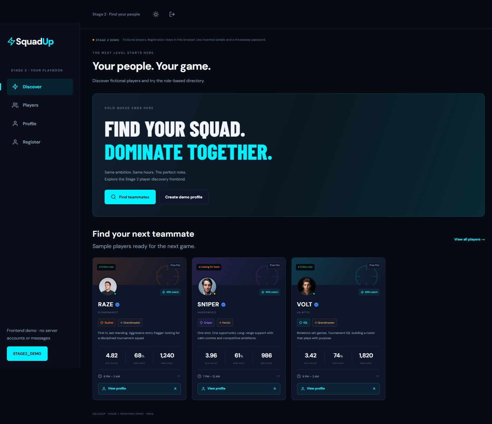
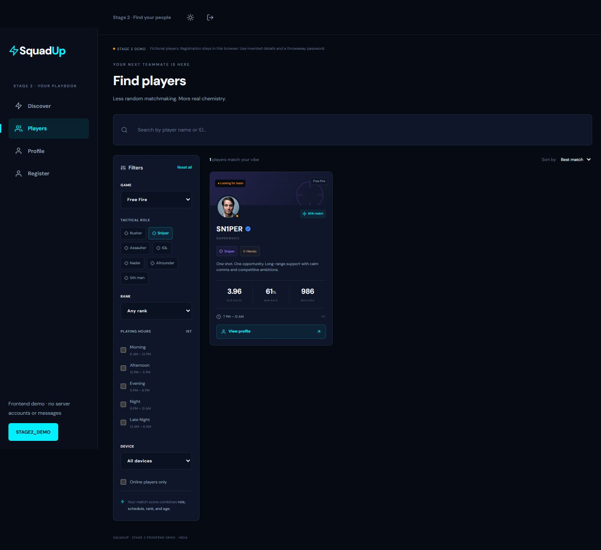
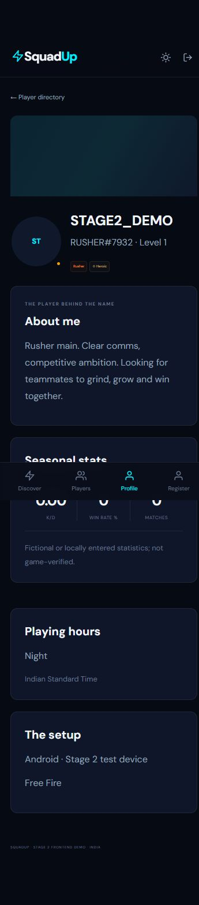
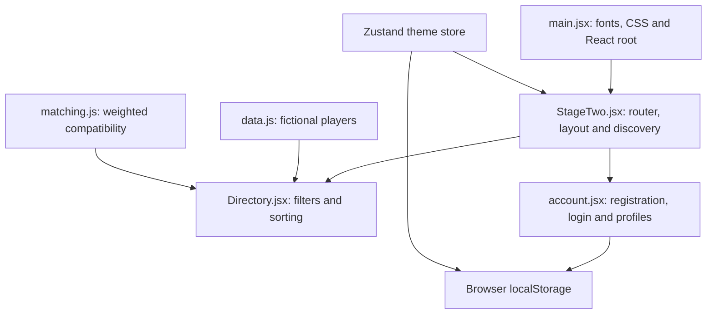

> Archived Stage 2 source guide. See the current [full-stack README](../README.md). Screenshots below show the earlier browser-only release.

# SquadUp — Esports Team Finder

**Find your squad. Dominate together.**

**Source release: Stage 2 · Player discovery and registration frontend · v0.2.0**

SquadUp is a mobile-first project for competitive mobile gamers in India. This release expands the Stage 1 PWA foundation with a player directory, filters, profile screens and a four-step registration/login demo. Free Fire is the primary game; sample data also demonstrates BGMI/CODM selection.

This is a **browser-only frontend demo**. Players, online indicators and statistics are fictional. No server account is created, no phone is verified, no SMS is sent and no real player is contacted. Use invented profile details and a throwaway password. Do not treat local registration as production authentication.

## Screenshots

Captured from Stage 2 on October 14, 2026. `STAGE2_DEMO` is a disposable fictional QA profile. Its credentials are not committed.

### Discovery — desktop



### Directory — role filtering



### Registered demo profile — mobile



The [archived Stage 1 guide](STAGE1.md) preserves its documentation and dark/light foundation screenshots. Those describe the earlier source release.

## What Stage 2 includes

| Feature               | Behavior                                                                                |
| --------------------- | --------------------------------------------------------------------------------------- |
| Discovery             | Gaming hero and sample player cards with profile navigation                             |
| Search                | Filter by display name or player ID                                                     |
| Tactical filters      | Role, rank, game, playing hours, device and sample online status                        |
| Sorting               | Best compatibility match or highest K/D                                                 |
| Filter reset          | Restores the Free Fire/default-sort view and clears filters/search                      |
| Compatibility preview | Client-side weighted role, schedule, rank and age score                                 |
| Player profiles       | ID, role, rank, bio, stats, playing hours, game, device and optional social details     |
| Registration          | Four steps: credentials → identity/bio → playstyle → device/socials                     |
| Local login           | Sign in to a demo account registered in this browser/origin                             |
| Sample exploration    | Explore the fictional SHADOW profile without registration                               |
| Persistence           | Demo account/session and theme survive reloads in the same browser                      |
| Responsive navigation | Fixed sidebar on desktop and bottom navigation on mobile                                |
| Themes/PWA            | Stage 1 theme persistence, manifest, icons and production service-worker setup retained |

The card action is **View profile**. Squads, invitations, messaging, live presence, API/database services, real AI, OTP and production authentication remain later source stages. Sample bio generation uses a fixed local template, not an AI model. Profile editing beyond initial registration is not included in this release.

## Tech stack

| Technology                            | Locked version | Use                                                                   |
| ------------------------------------- | -------------- | --------------------------------------------------------------------- |
| React / React DOM                     | 18.3.1         | Components and rendering                                              |
| React Router DOM                      | 7.18.4         | Client-side routes; approved free upgrade from the original v6 target |
| Vite                                  | 6.4.4          | Development and production builds                                     |
| Tailwind CSS / Vite adapter           | 4.3.3          | Styling pipeline with custom theme/component CSS                      |
| Zustand                               | 5.0.15         | Persisted theme and demo-session stores                               |
| React Hot Toast                       | 2.6.1          | Registration/login feedback                                           |
| React Icons                           | 5.7.0          | Feather icons                                                         |
| Vite PWA plugin                       | 1.3.0          | Manifest, Workbox generation and update hook                          |
| Fontsource DM Sans / Barlow Condensed | 5.3.0          | Bundled font files                                                    |
| React Vite plugin                     | 4.7.0          | React build integration                                               |
| Prettier                              | 3.9.10         | Formatting                                                            |
| Node.js                               | >=22           | Project prerequisite                                                  |

The lockfile pins installed versions. There is no Axios, Socket.io, Express, Sequelize, PostgreSQL or OpenAI dependency in this frontend release. No API keys, database or cloud account are required to run it locally.

## Step-by-step setup

1. Install Node.js 22 or a compatible later version with npm, and Git for cloning.
2. Clone and enter the repository:

   ```sh
   git clone https://github.com/tanishqsgit/ETF-SQUAD-UP.git
   cd ETF-SQUAD-UP
   ```

3. Install the exact dependency tree:

   ```sh
   npm ci
   ```

4. Start development:

   ```sh
   npm run dev
   ```

5. Open Vite's printed URL, normally **http://localhost:5173/**. If occupied, Vite can choose another port. The newer local full-stack workspace may already be using 5173; this release was tested separately on 5182.
6. Open **Players**, apply filters and choose **View profile**. For an account demo, use **Register**, complete all four steps and then try local sign-out/sign-in.
7. Build and preview production output:

   ```sh
   npm run build
   npm run preview
   ```

   Preview normally uses **http://localhost:4173/**. Stop a server with `Ctrl+C`.

For a separate fixed development port:

```sh
npm run dev -- --port 5182 --strictPort
```

These scripts bind to all interfaces (`0.0.0.0`); LAN access depends on network/firewall settings. They do not deploy a public website. The local demo requires no paid service; device/network costs are separate.

## Routes and user flow

| Route          | Screen                                                     |
| -------------- | ---------------------------------------------------------- |
| `/`, `/home`   | Discovery                                                  |
| `/search`      | Player directory; `?q=...` supplies an initial search      |
| `/profile/:id` | Sample player profile or current locally registered player |
| `/profile/me`  | Current demo profile; sign in/explore first                |
| `/register`    | Four-step local registration                               |
| `/login`       | Local login and sample-profile exploration                 |
| Other paths    | Page-not-found screen                                      |

Registration collects:

1. **Credentials:** valid-format Indian demo phone and an 8–72 character throwaway password.
2. **Identity:** 3–30 character display name, age 13–100, optional bio up to 200 characters and a sample-bio button.
3. **Playstyle:** one game, tactical role, rank and at least one playing slot in IST.
4. **Device/socials:** Android/iOS, model, optional YouTube URL, Instagram handle and Discord ID.

On completion, the browser assigns a UUID and role-based display ID, saves the demo account and shows its profile. Duplicate demo phone numbers in the same browser are rejected. Stats for a newly registered profile start at zero.

## How it works



`usePlayers` returns the fictional fixture array and, while signed in, the current newly registered demo player. Filtering and sorting happen in the browser. No API request is made. Compatibility uses 40% role synergy, 30% schedule overlap (intersection/union), 20% rank proximity and 10% age proximity. Unknown ranks and large age gaps lower the score. The score is a preview based on demo/profile data, not a guarantee of team performance.

Local registration uses a random salt and PBKDF2/SHA-256 with 100,000 iterations for its demo password verifier. The phone/profile, salt and verifier are stored under `squadup-stage2-accounts`; the current session is stored under `squadup-stage2-session`. Theme state uses `squadup-theme`. This is not server-enforced authentication: browser data can be inspected/modified, clearing it removes accounts, and signing in from another browser/origin will not find them. Never use real credentials.

Theme changes update the root `data-theme` attribute and browser theme-color. Dark remains the default; the original navy/cyan and light teal palettes are retained. Expanded responsive styles support the directory/sidebar/mobile navigation, with `stage2.css` styling the scoped discovery, registration and profile presentation. Sample avatars use external image URLs; initials remain available when images fail.

## Source structure

| File                               | Responsibility                                                               |
| ---------------------------------- | ---------------------------------------------------------------------------- |
| `index.html`                       | Metadata, favicon and React root                                             |
| `src/main.jsx`                     | Font/CSS imports and Strict Mode mount                                       |
| `src/StageTwo.jsx`                 | Routes, layout, discovery, theme effect and PWA update prompt                |
| `src/Directory.jsx`                | Search/filter controls, results, empty state and sorting                     |
| `src/components.jsx`               | Player cards, avatars, headings, demo notice and profile navigation          |
| `src/account.jsx`                  | Four-step registration, local password verifier, login and profile rendering |
| `src/data.js`                      | Fictional players, roles, ranks, time slots and sample profile               |
| `src/hooks.js`                     | Browser-only player data hook                                                |
| `src/matching.js`                  | Compatibility score and breakdown                                            |
| `src/stores.js`                    | Isolated persisted demo-session store                                        |
| `src/stores/themeStore.js`         | Persisted theme store                                                        |
| `src/styles.css`, `src/stage2.css` | Shared styling and Stage 2 presentation                                      |
| `tests/matching.test.js`           | Compatibility weight/boundary checks                                         |
| `public/`                          | SVG favicon and 192/512 PNG install icons                                    |
| `vite.config.js`                   | React, Tailwind and PWA plugins; base-path config                            |
| `docs/`                            | Screenshots and archived Stage 1 guide                                       |

## Commands and configuration

| Command           | Purpose                                           |
| ----------------- | ------------------------------------------------- |
| `npm ci`          | Install locked dependencies                       |
| `npm run dev`     | Start development server                          |
| `npm run build`   | Generate production/PWA assets in ignored `dist/` |
| `npm run preview` | Serve the already-built output locally            |
| `npm test`        | Run Node compatibility tests                      |
| `npm run format`  | Format source and Vite config with write mode     |
| `npm audit`       | Query dependency advisories                       |

`.env` is optional. `.env.example` contains `VITE_BASE_PATH=/`; this public setting controls assets, router basename, PWA scope/start URL and navigation fallback. Restart development/rebuild after changing it. Never put secrets into `VITE_` variables.

For a future project deployment at `/ETF-SQUAD-UP/`, set that base path before building. Windows PowerShell:

```powershell
$env:VITE_BASE_PATH = '/ETF-SQUAD-UP/'
npm run build
Remove-Item Env:VITE_BASE_PATH
```

Client-side routing requires the host to serve `index.html` for application paths. **GitHub Pages hosting is not enabled by this push**, and Pages does not provide that rewrite automatically. Configure a suitable SPA fallback or routing strategy before deploying deep links. Preview/build success alone is not a public deployment.

## PWA and verification

The production build generates the manifest, Workbox helper and service worker. JS/CSS/HTML/SVG/PNG/WOFF2 assets are precached; the navigation fallback uses the configured base. Runtime cache rules remain empty. Development mode does not enable this production offline cache. A prior successful production visit is needed for offline shell caching; sample external avatars may need a network connection.

The update prompt is conditional: a detected newer service worker offers **New version available · Update**. Device installation and a two-deployment update flow still need verification. The Stage 1 offline-shell result is documented in the archive; Stage 2 checks are recorded separately below.

Verified October 14, 2026:

- Production bundle and PWA generation.
- Combined sniper/iOS filters returned the expected sample player; View profile opened it.
- All four registration steps, sample bio and locally created profile.
- Profile/session persistence after reload, sign-out, incorrect-password rejection and successful login.
- Mobile filter toggle and one-result filtering; directory and profile had no horizontal overflow at 360px.
- Desktop screenshots and mobile profile screenshot; no browser console errors in the exercised flow.
- Compatibility unit tests and dependency audit (see release checks).

These checks cover the frontend demo, not backend security, real presence, latency, real-device installation or cloud integrations.

## Troubleshooting

| Issue                                    | Check                                                                                 |
| ---------------------------------------- | ------------------------------------------------------------------------------------- |
| A different SquadUp app appears          | Follow the printed Vite port; the full local app may use 5173                         |
| Login fails after switching port/browser | Accounts belong to their browser origin; register there or use Explore sample profile |
| Profile not found                        | Select a fixture or sign in/explore before `/profile/me`                              |
| No players match                         | Reset filters or choose another game                                                  |
| Mobile filters missing                   | Use the Filters button                                                                |
| Changes missing in preview               | Rebuild; preview does not rebuild source                                              |
| Old service-worker content               | Use its update prompt or inspect/reset that origin's browser cache                    |
| Hosted deep link returns 404             | Configure SPA fallback/routing and the correct base path                              |
| Avatar unavailable                       | External sample images need network access; initials provide a fallback               |

## Publication roadmap

| Stage | Scope                                                   | Status          |
| ----- | ------------------------------------------------------- | --------------- |
| 1     | React/Vite, themes and PWA foundation                   | Published       |
| 2     | Discovery, filters, profiles and registration frontend  | Current release |
| 3     | Squad roster, invitations and analysis interface        | Not published   |
| 4     | PostgreSQL, production authentication and API routes    | Not published   |
| 5     | Socket.io messaging, presence and media                 | Not published   |
| 6     | Full-stack hardening, integration checks and deployment | Not published   |

These source publication stages differ from milestones in the newer local workspace. This push contains Stage 2 frontend code and documentation only. No secrets, real users, local databases, uploads, backend code or newer squad/chat functionality are included.

Use actual commit dates and describe shipped behavior accurately. Keep generated builds, dependencies and private env files out of commits. No standalone license file has been added; do not infer a project license from dependency licenses.

**Built for players. Powered by teamwork.**
